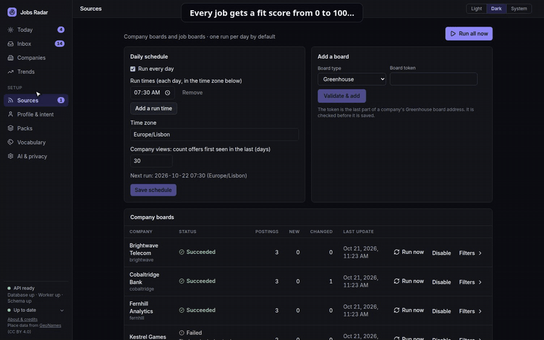

# Jobs Radar

[](https://github.com/innovation-ways/iw-jobs-radar/actions/workflows/ci.yml)
[](LICENSE)

Jobs Radar helps you separate the job offers that matter to you from everything else.

[](docs/videos/jobs-radar-demo.mp4)

[Watch the full video](docs/videos/jobs-radar-demo.mp4) (71 seconds, no sound, built-in demo data).

Follow the companies you care about and Jobs Radar checks their careers pages, as well as public job boards, for new offers. Every new offer is read, scored against your own career profile and search intent, and ranked in a personal inbox, so you are told when a company you follow publishes something relevant and you can see at a glance why it fits or why it does not. Offers that break a rule you set (for example, on-site only, or the wrong role family) are set aside with the reason and you dont need to waste time with them.

Every score can be explained. A local AI model reads each offer and quotes the passages that matter, such as the stack, the location or the pay. Fixed rules then turn those findings into a score, using the weights you chose. The AI never decides the final number, so the same offer always gets the same score, and you can see exactly why.

A trends view shows how the offers relevant to you change over time: which technologies and role families are growing, week by week.

Everything runs on your machine, and your data stays with you.

## What it does

- **Sources**: company boards (Greenhouse, Lever, Ashby, SmartRecruiters, Eightfold) and job boards
  (Arbeitnow, Jobicy, Himalayas, ITJobs.pt), managed from the web UI with per-source status.
- **Career profile and search intent**: explicit, versioned and yours. A CV import only creates
  proposals you review item by item; the uploaded CV is never stored.
- **Explainable scoring**: the AI reads each job and judges it per dimension with quoted evidence;
  the final score is a deterministic function of those judgements (hard gates, then weights that
  sum to 100). No model is involved in the last step.
- **Inbox**: one item per real opportunity (duplicates across sources are linked), keyboard-first
  triage, a daily digest, company dossiers and weekly market trends.
- **AI agents (optional, off by default)**: an MCP server lets Claude Code or another agent read your
  inbox, explain a score, show trends and, if you allow it, shortlist or ignore jobs.
  See [docs/operations/mcp-server.md](docs/operations/mcp-server.md).
- **Privacy**: "No AI" is the default. Job analysis is local only (Ollama); remote AI is limited to
  CV import, after per-document consent and with contact details redacted.

## Screenshots

A tour of the screens (Today, Inbox, Set aside, Companies, Trends, Sources, Scoring weights, Profile and
AI & privacy, light and dark) is in [docs/images](docs/images/). All of them show the built-in demo, with
invented data.

## Quick start

Nothing is built: the images are pulled from the GitHub Container Registry. The commands are the
same on every system; what you install first depends on yours.

| System | Install first | Local AI (optional) | Tested |
|---|---|---|---|
| Linux | [Docker Engine](https://docs.docker.com/engine/install/) with Compose v2 | [Ollama for Linux](https://ollama.com/download) | yes |
| Windows | [Docker Desktop](https://docs.docker.com/desktop/setup/install/windows-install/) (with WSL 2) | [Ollama for Windows](https://ollama.com/download) | yes |
| macOS | [Docker Desktop](https://docs.docker.com/desktop/setup/install/mac-install/) (Intel or Apple Silicon) | [Ollama for macOS](https://ollama.com/download) | not yet |

Details and tips for each system are in [docs/operations/install.md](docs/operations/install.md).

### Try it with demo data

The demo has its own database and volume; your real data is never touched. It runs the real pipeline
on invented postings and a scripted "model", so it needs no network and no AI. The company and
job-board names are invented, and the board names shown (for example Arbeitnow) only label the demo
sources.

```bash
docker compose -f docker-compose.demo.yml up
# open http://127.0.0.1:5181
docker compose -f docker-compose.demo.yml down -v    # remove it
```

### Install it

```bash
docker compose -f docker-compose.release.yml up -d
# open http://127.0.0.1:5180
```

The first start generates the key that encrypts stored credentials and the database password, and
keeps them in a Docker volume. **Back the key up** (the command is in
[docs/operations/install.md](docs/operations/install.md)): without it, stored credentials (AI
provider and job-board keys) cannot be recovered. Only the web UI is published, on `127.0.0.1`.
Versions, upgrades, backups and the optional local AI are in the same guide.

AI extraction is off until you turn it on and choose a local model in the *AI & privacy* screen.
Without it, jobs are still collected and shown as "not evaluated".

## Development

Prerequisites: Docker, [`uv`](https://docs.astral.sh/uv/), Node 22 with pnpm through corepack, and
optionally [Ollama](https://ollama.com) for local AI.

```bash
./jobs-radar.sh --init-env        # creates .env with a random database password and credential key
./jobs-radar.sh --quick-start     # database, API and worker (Docker) plus the frontend (Vite)
./jobs-radar.sh --urls            # where to open the app (default http://localhost:5180)
make help                         # every command: tests, quality gates, backups, ...
```

The demo without Docker images, from source: `make demo` (or `./jobs-radar.sh --demo`) starts
PostgreSQL, builds the demo database `jobs_radar_demo`, an idle worker, the API (port 8101) and the
UI (port 5181); `make demo-stop` stops it. Logs are in `logs/demo-*.log`. The step-by-step targets
(`make demo-seed`, `demo-worker`, `demo-api`, `demo-frontend`) still exist. Never start the real
worker against the demo database: it would try to collect the invented boards.

A local model is allowed from the *AI & privacy* screen ("Allow a model server on this computer");
`JOBS_RADAR_ALLOW_LOCAL_PROVIDERS` in `.env` does the same and locks the switch on.

## How it was built

Jobs Radar was developed with AI assistance (Claude Code). The architecture, the decisions
([ADR log](docs/decisions/architecture-decision-log.md)) and the verification are the maintainer's
work: changes are written test-first and must pass the quality gates (`make check`: lint, strict
types, import boundaries, security linting, licences, unit and integration tests; `make coverage`
enforces 80%). Read the code
and the tests as you would any other project, and open an issue if something looks wrong.

## Security

Version 1 has **no authentication**. The API and database listen on loopback by default; keep them
there or on a trusted LAN, never on the public internet. See [SECURITY.md](SECURITY.md) to report a
vulnerability.

The optional **MCP server** for AI agents is off unless `JOBS_RADAR_MCP_ENABLED=true` in `.env`. It
adds no network port and no authentication, and **everything an agent reads, your full profile
included, goes to the model behind it**: to the provider with a cloud agent, nowhere with a local
one. Job text is passed to the agent as marked untrusted data, and the tools that change anything
need a second switch. Read [docs/operations/mcp-server.md](docs/operations/mcp-server.md) first.

## Documentation

- Operations (installing from images, configuration, backup and restore, sources and providers, the MCP server for AI
  agents, known limitations):
  [`docs/operations/`](docs/operations/)
- Scoring rules and data shapes (taxonomies, profile, intent, gates, weights):
  [`docs/design/domain-schemas-and-matching-rules.md`](docs/design/domain-schemas-and-matching-rules.md)
- Architecture decisions (why things are the way they are):
  [`docs/decisions/architecture-decision-log.md`](docs/decisions/architecture-decision-log.md)
- Data-source terms and obligations: [`docs/legal/data-sources.md`](docs/legal/data-sources.md)
- Database data dictionary: [`docs/database/schema.md`](docs/database/schema.md)
- UI mock-ups: [`docs/design/`](docs/design/)

## Contributing

Contributions are welcome: read [CONTRIBUTING.md](CONTRIBUTING.md) (tests first, DCO sign-off) and
the [Code of Conduct](CODE_OF_CONDUCT.md).

## Licence and credits

Apache-2.0, see [LICENSE](LICENSE) and [NOTICE](NOTICE). Third-party licences are in
[THIRD_PARTY_LICENSES.md](THIRD_PARTY_LICENSES.md). Place lookup uses
[GeoNames](https://www.geonames.org) data (CC BY 4.0). Job data belongs to its sources; each board is
credited in the app.
