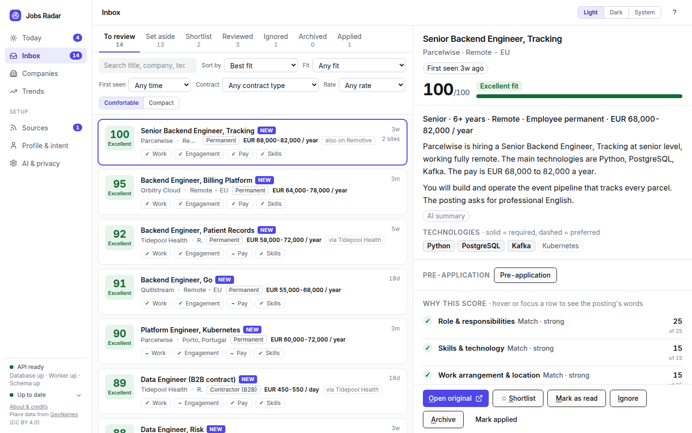
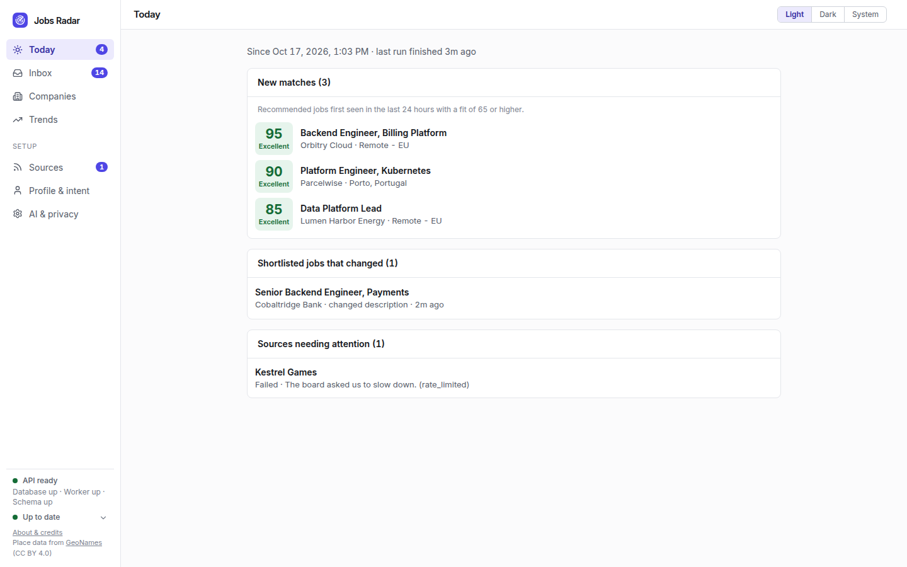
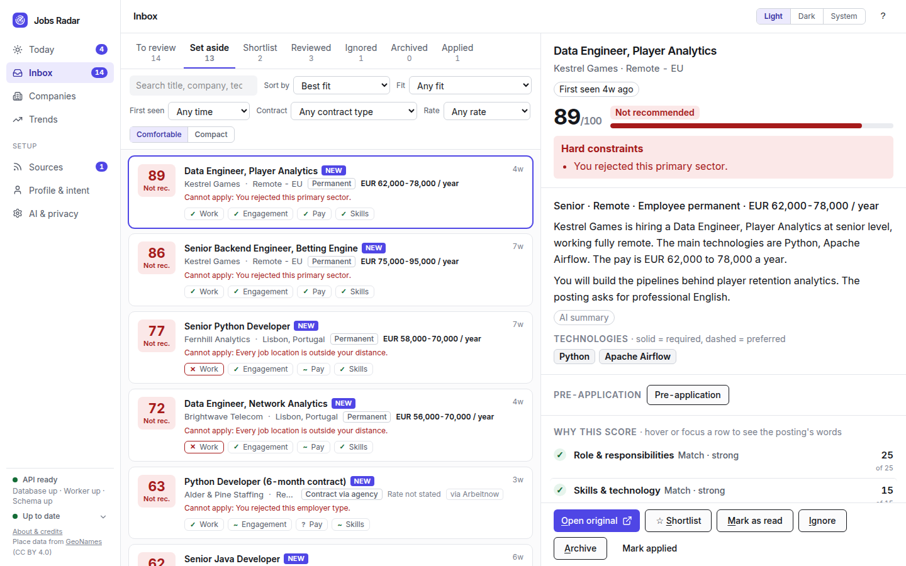
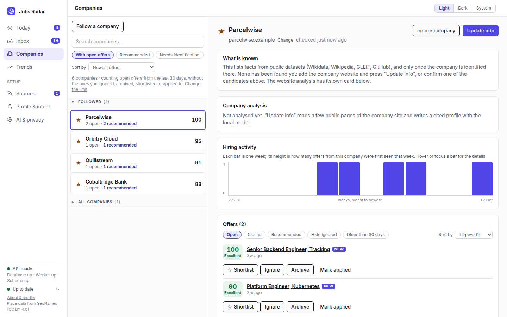
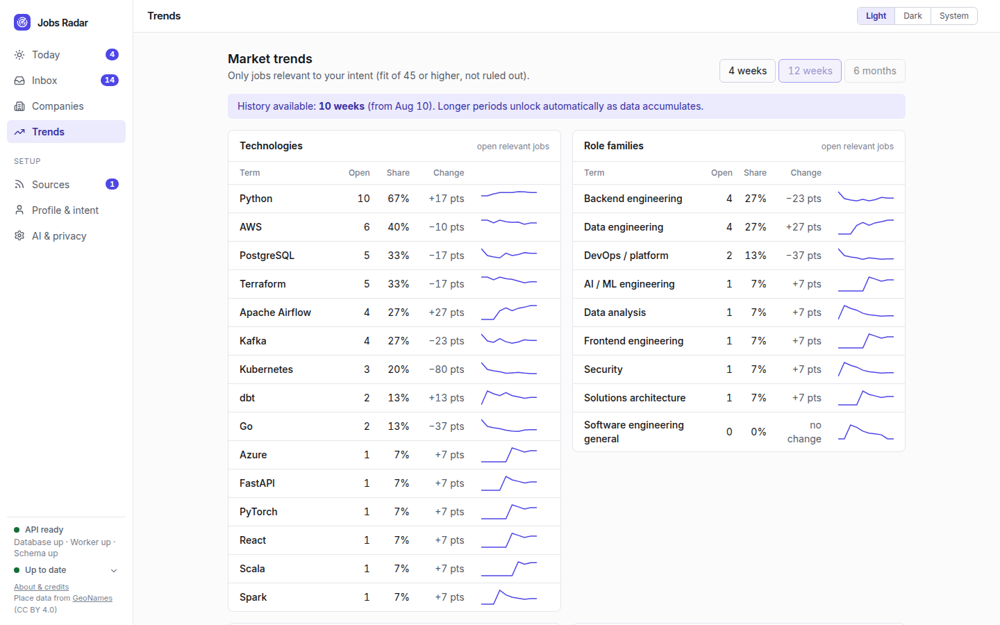
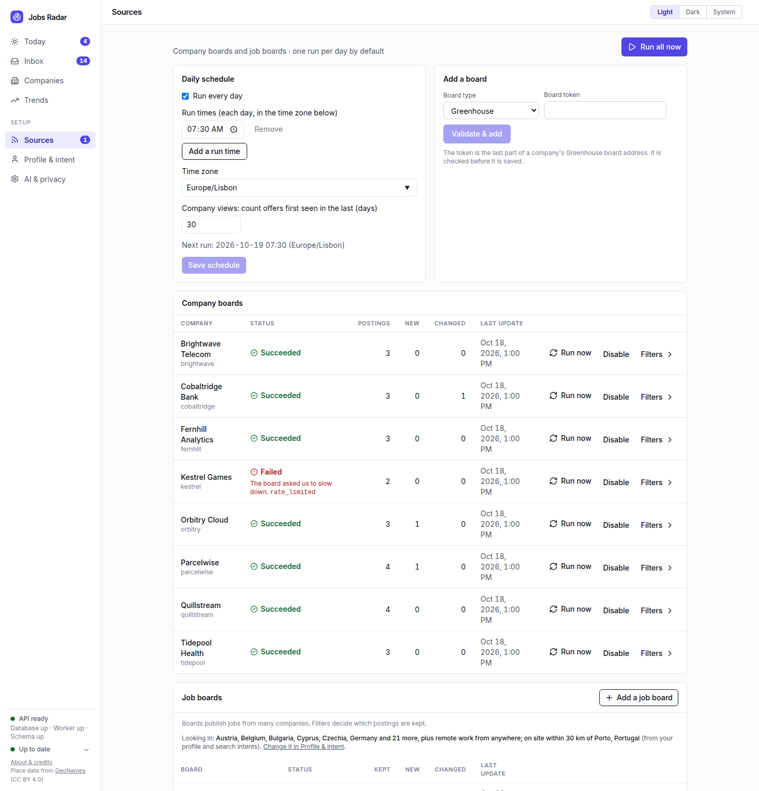
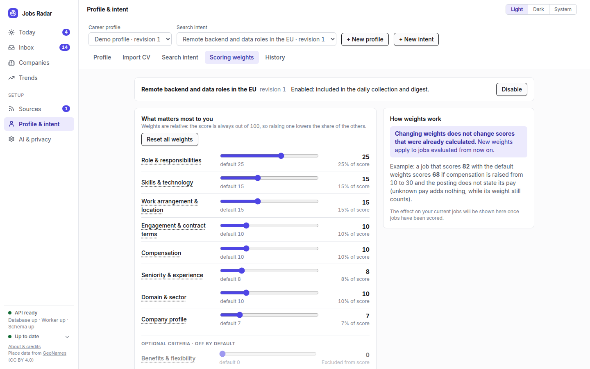
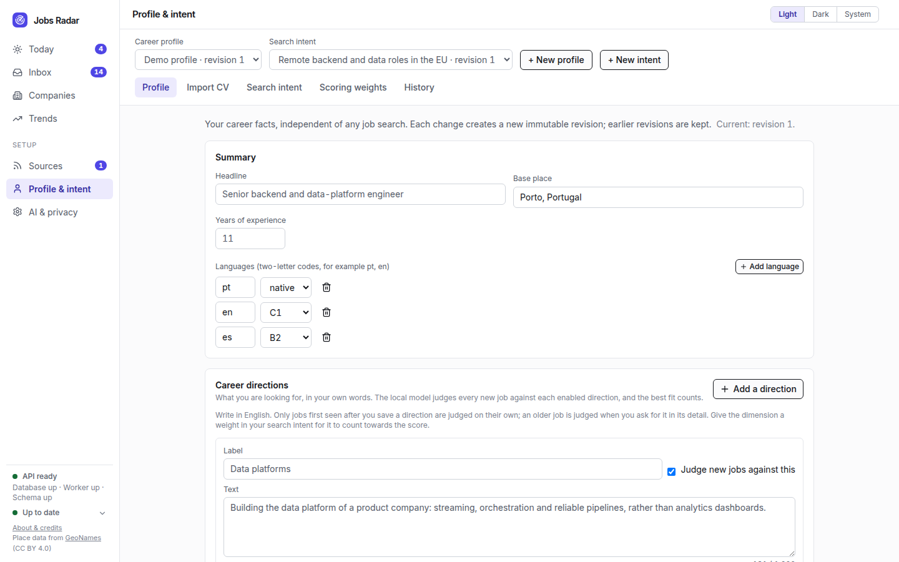
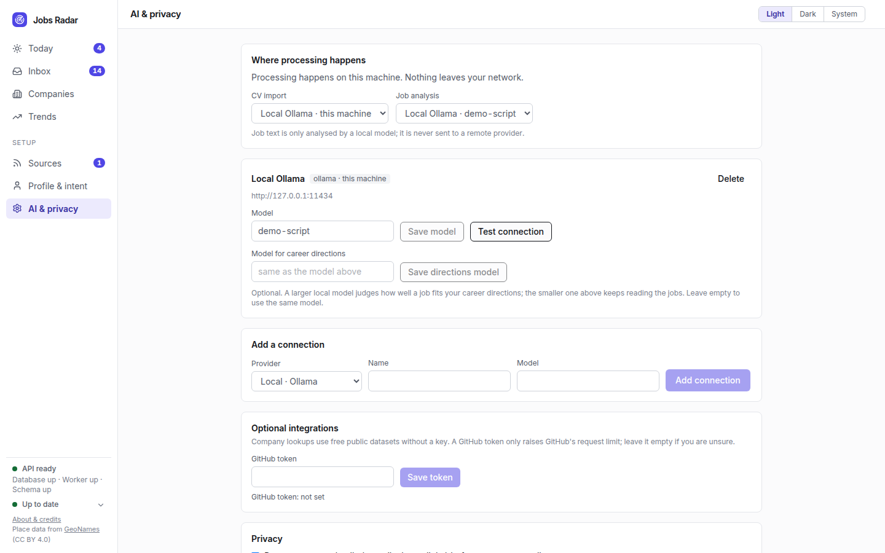

# Jobs Radar

[](https://github.com/innovation-ways/iw-jobs-radar/actions/workflows/ci.yml)
[](LICENSE)

A **local-first, single-user job-market radar**. It collects jobs from permitted public sources,
extracts what matters with an AI model (local by default), scores each job against your career
profile and search intent with an explainable deterministic rule set, and keeps a personal inbox,
company dossiers and market trends. Your data stays on your machine.

## What it does

- **Sources**: company boards (Greenhouse, Lever, Ashby, SmartRecruiters, Eightfold) and job boards
  (Arbeitnow, Jobicy, Himalayas, ITJobs.pt), managed from the web UI with per-source status.
- **Career profile and search intent**: explicit, versioned and yours. A CV import only creates
  proposals you review item by item; the uploaded CV is never stored.
- **Explainable scoring**: the AI reads each job and judges it per dimension with quoted evidence;
  the final score is a deterministic function of those judgements (hard gates, then weights that
  sum to 100). No model is involved in the last step.
- **Inbox**: one item per real opportunity (duplicates across sources are linked), keyboard-first
  triage, a daily digest, company dossiers and weekly market trends.
- **Privacy**: "No AI" is the default. Job analysis is local only (Ollama); remote AI is limited to
  CV import, after per-document consent and with contact details redacted.

## Screenshots

All screenshots show the built-in demo: an invented persona, invented companies and invented
postings. Nothing in them is real data (see [Try it with demo data](#try-it-with-demo-data)).

**Inbox**: every job scored against your intent, with the reasons behind the score.



| | |
|---|---|
|  **Today**: the daily digest. |  **Set aside**: jobs that break a rule you set, with the reason. |
|  **Companies**: dossiers and hiring activity. |  **Trends**: what the market asks for, week by week. |
|  **Sources**: schedule and the status of every board. |  **Scoring weights**: you decide what counts. |
|  **Profile and intent**: explicit and versioned. |  **AI and privacy**: off by default. |

A dark theme is included: [Inbox in dark mode](docs/images/03-inbox-dark.png).

## Quick start

Prerequisites: Docker, [`uv`](https://docs.astral.sh/uv/), Node 22 with pnpm through corepack, and
optionally [Ollama](https://ollama.com) for local AI.

```bash
./jobs-radar.sh --init-env        # creates .env with a random database password and credential key
./jobs-radar.sh --quick-start     # database, API and worker (Docker) plus the frontend (Vite)
./jobs-radar.sh --urls            # where to open the app (default http://localhost:5180)
make help                         # every command: tests, quality gates, backups, ...
```

### Try it with demo data

The demo lives in its own database (`jobs_radar_demo`); your real data is never touched. It runs the
real pipeline on invented postings and a scripted "model", so it needs no network and no AI. The
company and job-board names are invented, and the board names shown (for example Arbeitnow) only
label the demo sources.

```bash
./jobs-radar.sh --quick-start     # PostgreSQL must be running
make demo-seed                    # builds the demo database (drops and recreates it)
make demo-worker                  # in a terminal of its own: keeps the "worker up" signal alive
make demo-api                     # in another: API on http://127.0.0.1:8101
make demo-frontend                # in another: open http://localhost:5181
```

Never start the real worker against the demo database: it would try to collect the invented boards.

AI extraction is off until you turn it on in `.env` (`JOBS_RADAR_EXTRACTION_ENABLED`,
`JOBS_RADAR_ALLOW_LOCAL_PROVIDERS`) and choose a local model in the *AI & privacy* screen. Without
it, jobs are still collected and shown as "not evaluated".

## Security

Version 1 has **no authentication**. The API and database listen on loopback by default; keep them
there or on a trusted LAN, never on the public internet. See [SECURITY.md](SECURITY.md) to report a
vulnerability.

## Documentation

- Operations (configuration, backup and restore, sources and providers, known limitations):
  [`docs/operations/`](docs/operations/)
- Architecture decisions (why things are the way they are):
  [`docs/decisions/architecture-decision-log.md`](docs/decisions/architecture-decision-log.md)
- Data-source terms and obligations: [`docs/legal/data-sources.md`](docs/legal/data-sources.md)
- Database data dictionary: [`docs/database/schema.md`](docs/database/schema.md)
- UI mock-ups: [`docs/design/`](docs/design/)

## Contributing

Contributions are welcome: read [CONTRIBUTING.md](CONTRIBUTING.md) (tests first, DCO sign-off) and
the [Code of Conduct](CODE_OF_CONDUCT.md).

## Licence and credits

Apache-2.0, see [LICENSE](LICENSE) and [NOTICE](NOTICE). Third-party licences are in
[THIRD_PARTY_LICENSES.md](THIRD_PARTY_LICENSES.md). Place lookup uses
[GeoNames](https://www.geonames.org) data (CC BY 4.0). Job data belongs to its sources; each board is
credited in the app.
